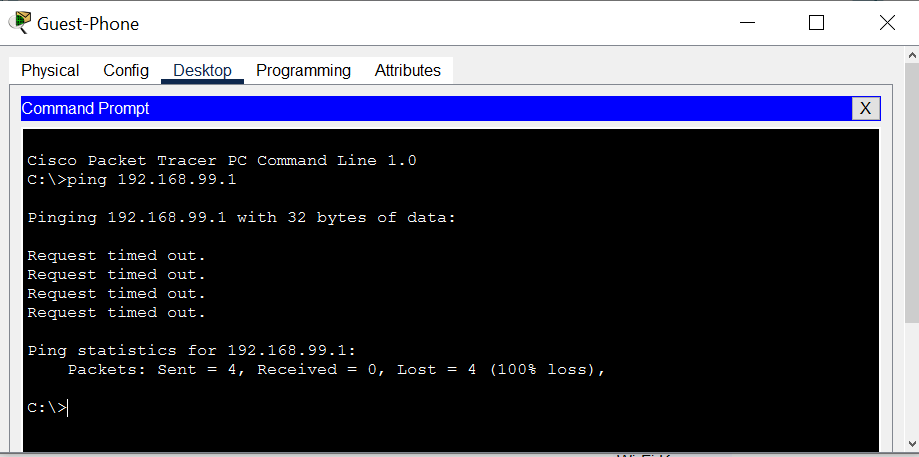
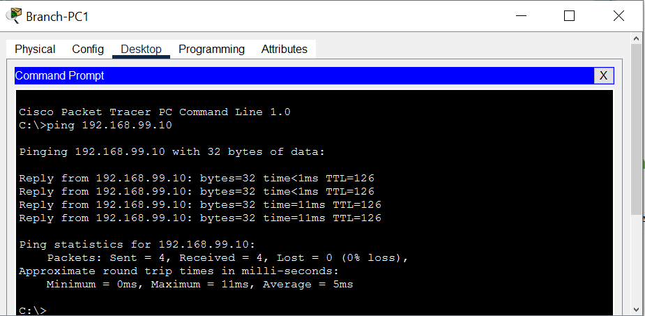

---
### 👋 Tentang Project Ini

> **Status:** Mahasiswa Semester 1 - Teknik Informatika (552012610009)
> **Project:** Personal Advanced Lab - Eksplorasi Networking dengan Cisco Packet Tracert sebagai project pribadi dan portofolio.

Aku sengaja ngoprek topologi yang lebih kompleks dari Project Semester 1 (yang cuma VLAN & Static Routing) biar pas masuk Project semester 2 bisa buat project yang lebih kompleks. Topologi ini adalah **Hybrid HQ-Branch dengan OSPF + Security ACL**.

### ✨ Apa Yang Aku Pelajari di Lab Ini?
Ini yang bikin beda dari project Semester 1:

- **Routing Dinamis:** OSPF Area 0 Single Area, Point-to-Point Link (192.168.100.0/30) bukan cuma static route
- **DHCP Relay:** DHCP Server terpusat di HQ (VLAN 99) + `ip helper-address` di Branch, jadi Branch nggak perlu bikin server lagi
- **Multi-SSID Workaround:** Packet Tracer nggak support Multi-SSID 1 AP, jadi solusinya pakai 2 AP fisik (AP-Work VLAN 30, AP-Guest VLAN 40)
- **Security:** Extended ACL `BLOCK-GUEST` - Memblokir Guest Wi-Fi mengakses Server internal HQ

### 🧪 Bukti Keberhasilan!

| No | Test | Hasil | Status |
| :--- | :--- | :--- | :--- |
| 1 | Guest-Phone (VLAN 40) -> Server HQ (VLAN 99) | **Request Timed Out (100% Loss)** | ✅ **ACL Berhasil Block!** |
| 2 | Branch-PC1 (VLAN 30 - Karyawan) -> Server HQ | Reply | ✅ Akses Karyawan Normal |
| 3 | HQ-PC1 -> Branch-PC1 | Reply | ✅ OSPF Connected |

**Screenshot Bukti:**

*Ping dari Guest-Phone ke Server HQ 192.168.99.1 = 100% Loss, artinya ACL BLOCK-GUEST bekerja!*

*Ping dari Branch-PC1 ke Server HQ 192.168.99.10 = 0% Loss, artinya Akses Karyawan ke Server Normal!*

*Ping dari HQ-PC1 ke Branch-PC1 192.168.20.10 = 0% Loss, artinya Topologi OSPF saling terhubung! (all connected)*

### 📁 Isi Repo
- `OSPF-HQ-Branch-ACL.pkt` 
- `bukti-acl-block.png`
- `OSPF-HQ-Branch-ACL.png` 

### 🛠️ Tools
- Cisco Packet Tracer 8.x
- 2911 Router, 2960 Switch, Smartphone-PT

---
**By:** Satria Bagas Sejati - 552012610009  

